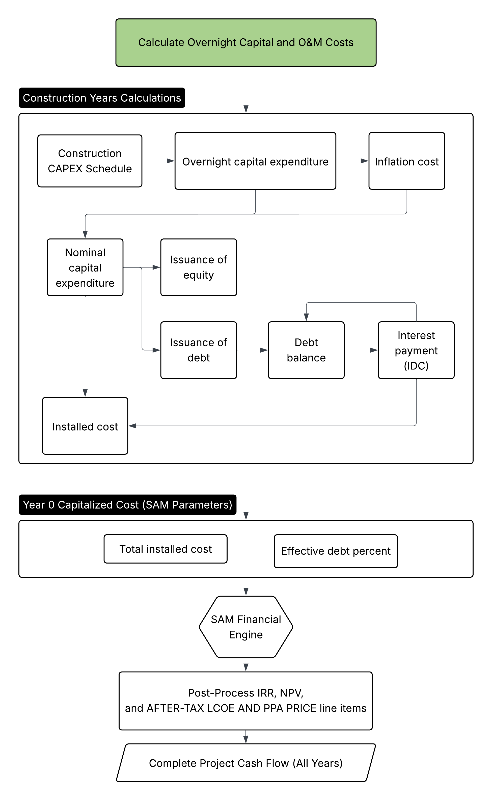
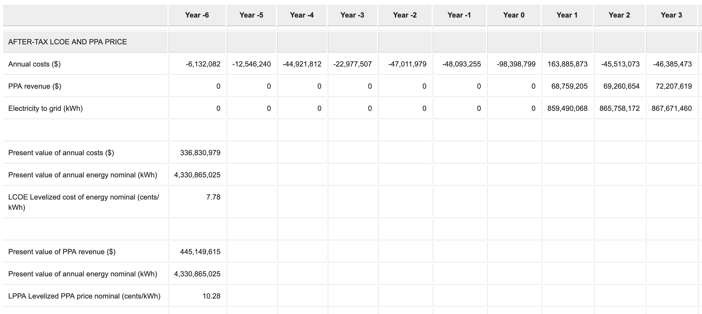

# SAM Economic Models: Multiple Construction Years

[Multiple Construction Years example web interface link](https://gtp.scientificwebservices.com/geophires/?geophires-example-id=example_SAM-single-owner-PPA-5)

GEOPHIRES SAM Economic Models support multi-year construction timelines to deliver accurate, time-adjusted financial
metrics, including LCOE, IRR and NPV for projects with extended development periods.
This feature models the pre-revenue phase to capture the real-world economic impact of capital deployment timing,
inflation, royalty supplemental costs (such as option payments or land leases), and Interest During Construction (IDC).
This ensures that key investment decision metrics correctly reflect the time value of money leading up to the Commercial
Operation Date (COD).

To enable this feature, set the `Construction Years` parameter to the desired duration (e.g., 3). The spending profile
is defined by the `Construction CAPEX Schedule`, which allocates a percentage of the `Overnight Capital Cost` to each
pre-revenue year. Users can further refine the financing model using `Bond Financing Start Year` to delay debt
drawdowns (funding early years purely with equity) and adjust `Inflation Rate During Construction` or
`Inflated Bond Interest Rate During Construction` to match specific market conditions.

## Construction Cash Flows

Multiple Construction Years example cash flow CSV: [example_SAM-single-owner-PPA-5_cash-flow.csv](https://github.com/softwareengineerprogrammer/GEOPHIRES/blob/main/tests/examples/example_SAM-single-owner-PPA-5_cash-flow.csv)

The `CONSTRUCTION` cash flow category displays detailed financial movements during the pre-operational phase.
Construction-specific line items are suffixed with `[construction]`.
Construction years are indexed relative to the first year of operations (Year 1).
A project with three construction years will have cash flows in Year -2, Year -1 and Year 0.
A project with seven construction years, as in the example below, will start in Year -6.

## Construction Years Calculations

For each construction year, the `CONSTRUCTION` cash flow is calculated as follows:

1. **CAPEX Deployment**: GEOPHIRES calculates `Overnight capital expenditure [construction]` as a
   percentage of the total `Overnight Capital Cost` based on the `Construction CAPEX Schedule`.
1. **Inflation**: An inflation adder is calculated using `Inflation Rate During Construction` and added to the overnight
   cost to yield `Nominal capital expenditure [construction]`.
1. **Royalty Supplemental Costs**: Any `Royalty Supplemental Payments`[^royalties-docs] scheduled during the construction phase are applied as an additional capital cost for the year. This ensures that pre-revenue site control costs (such as option payments or land leases) are properly capitalized into the project basis.
1. **Debt & Equity Draws**: Costs are covered by issuance of equity and debt based on `Fraction of Investment in Bonds`.
   Debt
   financing can be delayed by specifying `Bond Financing Start Year`. Years prior to this threshold are financed 100%
   by equity.
1. **IDC (Interest During Construction)**: `Capitalized interest [construction]` on the accumulated debt balance is calculated using
   `Inflated Bond Interest Rate During Construction`. This interest is capitalized (added to
   `Debt balance [construction]`) rather than paid out as cash.
1. **Annual Installed Cost**: The annual `Installed cost [construction]` is the sum of
   `Nominal capital expenditure [construction]` and `Capitalized interest [construction]` (capitalized IDC).

[^royalties-docs]: See [royalties documentation](SAM-Economic-Models.html#royalties).

## Operational Years (SAM Integration)

At the end of the construction phase, total installed cost and effective debt percentage are passed to the SAM financial
engine.
This ensures the operational model starts with the correct depreciation basis and loan principal.
Annual `Installed cost [construction]` values are
summed to calculate the total installed cost that is passed to SAM (`total_installed_cost`).
The final `Debt balance [construction]`, which includes capitalized IDC, is divided by the total installed cost to
compute an effective debt percentage that is passed to SAM (`debt_percent`).

### Construction Debt at COD

GEOPHIRES does not model a separate construction loan with its own repayment schedule. Instead, debt drawn during
construction is effectively refinanced as term debt at COD, similar to a construction loan that converts to a term loan
when the project begins operating:

1. During construction, debt draws and capitalized IDC accumulate in `Debt balance [construction]`. No interest or
   principal is paid in cash before COD.
1. At COD, the final (Year 0) `Debt balance [construction]` becomes the principal of the term debt in SAM
   (`Size of debt`) through the effective debt percentage.
1. From Year 1, the term debt accrues interest at `Inflated Bond Interest Rate` (instead of
   `Inflated Bond Interest Rate During Construction`) and is repaid in level annual payments over `Debt Tenor` years,
   which defaults to `Plant Lifetime`.

`Debt Tenor` is counted from COD, so debt is outstanding for longer than the tenor when it is drawn before the final
construction year.
For example, with 3 construction years (Year -2 to Year 0), debt drawn from the first construction year, and a 15-year
`Debt Tenor`, debt is outstanding from Year -2 until it is repaid at the end of Year 15.

## Post-Processing (Timeline-adjusted Metrics)

After SAM computes the operational cash flows, GEOPHIRES merges the construction phase and
operational phase net cash flows. It then post-processes applicable line items to calculate timeline-adjusted project-level metrics, as described below.

Standard SAM line items that are not subject to post-processing, such as `Cash flow from investing activities ($)`
and `Total pre-tax returns ($)`, reflect the capitalized equivalent basis at Year 0, displaying no values during the
pre-revenue construction period.

### IRR and NPV
The merged `After-tax net cash flow ($)` row represents the complete project lifecycle:

- Years -N to 0: Contains `After-tax net cash flow [construction] ($)` (equity outflows).
- Years 1+: Contains `Total after-tax returns ($)` from operations.

`After-tax cumulative IRR (%)` and `After-tax cumulative NPV ($)` are re-calculated based on this unified cash flow
stream to account for the time value of money during the construction delay.

The corresponding result case report metrics (`After-tax IRR` and `Project NPV`) reflect this adjustment,
as do other relevant case report metrics including `Project VIR=PI=PIR` and `Project MOIC`.

### After-tax LCOE and PPA Price

Line items in the `AFTER-TAX LCOE AND PPA PRICE` category are post-processed to yield timeline-adjusted LCOE and LPPA.

The result case report LCOE metric (`Electricity breakeven price`) reflects the post-processed `LCOE Levelized cost of energy nominal (cents/kWh)` value.

---

See also [SAM Economic Models documentation](SAM-Economic-Models.html).
